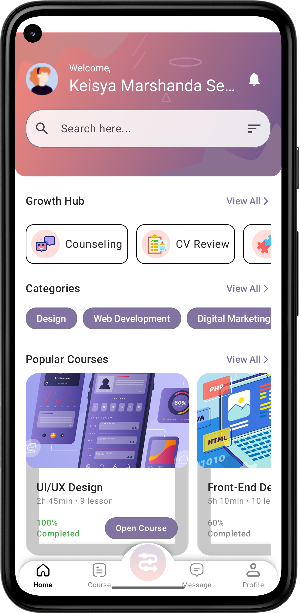
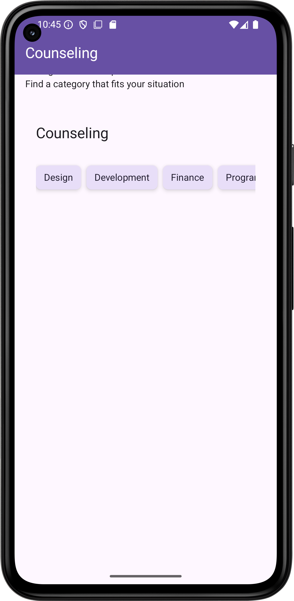
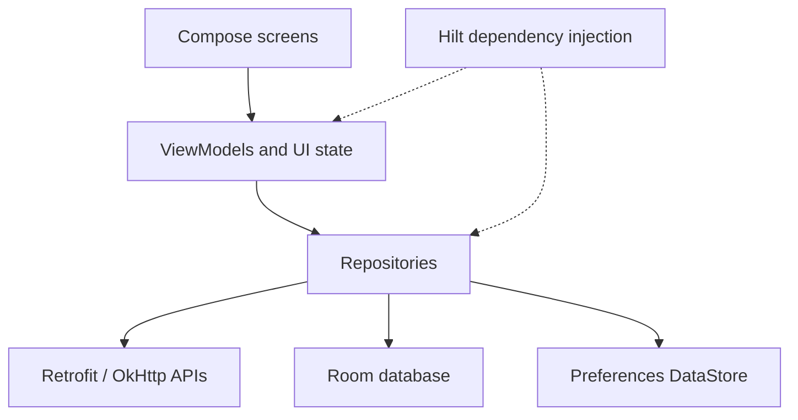

<div align="center">

# Elevate

### Learn new skills. Explore your next career step.

A native Android career-development prototype built with **Kotlin** and **Jetpack Compose**, bringing course discovery, career counseling, and CV reviews into one app.


[Preview](#preview) · [Features](#features) · [Architecture](#architecture) · [Getting started](#getting-started)

</div>

## Preview

Existing screenshots from this repository illustrate the interface; they are not verification of the current build or backend availability.

<table>
  <tr><th>Home</th><th>Career counseling</th><th>CV review</th></tr>
  <tr>
    <td></td>
    <td></td>
    <td></td>
  </tr>
</table>

## Features

| Area | Implementation in this repository |
| --- | --- |
| Authentication & onboarding | Login, registration, assessment submission, and session preferences through DataStore. Requires the API. |
| Course discovery | Course search with API integration and Room caching; category and My Course screens also use sample data. Details currently contain one sample course. |
| Career counseling | Consultant browsing, categories, search, and detail screens, with local caching. Booking/payment integration is unfinished. |
| CV review | PDF upload, review results, history, detail/delete flows, local caching, and PDF generation code. Analysis comes from the backend. |
| Profile | Profile retrieval/editing and image selection, with API-backed updates. |
| Job matching & roadmap | Job matching upload/results share a ViewModel across navigation; the roadmap displays sample course data. Job matching requires the API. |

## Engineering highlights

- **Declarative UI:** Compose screens, reusable components, Material 3, and Poppins typography.
- **Reactive state:** ViewModels expose Flow/StateFlow; coroutines handle asynchronous work.
- **Dependency injection:** Hilt provides repositories, API clients, and database dependencies.
- **Data separation:** Repository interfaces and implementations connect ViewModels to Retrofit/Room; mappers translate cached entities and models.
- **Local persistence:** Room stores courses, consultants, counseling categories, search history, and CV reviews. DataStore stores session/profile preferences.
- **Android integrations:** Document/image selection, FileProvider, Coil image loading, and PDFBox-based PDF generation.

## Architecture

An MVVM-style structure within a single Android application module. Some prototype screens access sample data directly.



```text
app/src/main/java/com/application/elevate/
├── api/             # Additional API interfaces
├── data/
│   ├── api/         # REST service interfaces
│   ├── database/    # Room database, DAOs, and entities
│   ├── datastore/   # Preferences DataStore setup
│   ├── di/          # Hilt modules
│   ├── dummy/       # Sample content
│   ├── mapper/      # Entity/model conversions
│   └── repository/ # Data access and caching
├── model/           # Models and request/response objects
├── service/         # PDF generation
├── ui/              # Feature screens, components, and theme
├── util/            # Network utilities
├── viewmodel/       # Feature ViewModels
├── ElevateApp.kt    # Application entry point
└── MainActivity.kt  # Activity and navigation graph
```

## Tech stack

| Layer | Technologies |
| --- | --- |
| Language & UI | Kotlin 1.9.22, Jetpack Compose, Material 3 |
| State & async work | AndroidX ViewModel, Kotlin coroutines, Flow/StateFlow |
| Navigation | Navigation Compose, Accompanist navigation animation |
| Dependency injection | Dagger Hilt 2.47 |
| Networking | Retrofit 2.9.0, OkHttp, Gson |
| Persistence | Room 2.6.1, Preferences DataStore |
| Media & documents | Coil 2.5.0, PDFBox Android |
| Build | Gradle wrapper 8.10.2, Android Gradle Plugin 8.3.2 |

## Getting started

### Prerequisites

- Android Studio with JDK 17 configured as the Gradle JDK.
- Android SDK Platform 35, matching the checked-in compile/target SDK.
- A device or emulator running API 25 (Android 7.1) or newer.
- A compatible backend for authentication and API-backed features. The backend is not included here.

### Run locally

1. Clone this repository and open its root folder in Android Studio.
2. Let Android Studio configure the SDK path in your local `local.properties` and sync Gradle.
3. Configure `ELEVATE_API_BASE_URL` in your user Gradle properties (`~/.gradle/gradle.properties`), or pass `-PELEVATE_API_BASE_URL=https://your-backend.example/api/` to Gradle. Replace the example with your compatible backend. The URL must use HTTPS and end in `/`. All Retrofit clients use this setting.
4. Select the `app` configuration and run it on your device/emulator.

The default host, `test2.ciet.site`, could not be resolved during the local check on 2026-09-18. A working compatible HTTPS backend is required for login and remote features. There is no standalone demo mode that bypasses authentication; backend workflows have not been verified end to end.

### Build and checks

Windows PowerShell:

```powershell
.\gradlew.bat assembleDebug
.\gradlew.bat testDebugUnitTest lintDebug
```

macOS / Linux:

```bash
bash ./gradlew assembleDebug
bash ./gradlew testDebugUnitTest lintDebug
```

After a successful build, the debug APK is at `app/build/outputs/apk/debug/app-debug.apk`. Regression tests cover private CV cache session changes, stale requests, legacy cache cleanup, and missing sample course details. Broader feature/UI coverage is still needed.

Local validation on 2026-09-18: **10 unit tests passed**, **lint passed with 0 errors** (232 warnings remain), and **the debug APK built successfully**. See the [review and validation notes](docs/CODE_REVIEW.md) for scope and limitations.

## Current limitations

This repository demonstrates Android implementation work and is still a prototype.

- Message and notification-center actions show explicit unavailable screens. Profile notification settings, activity, help, roadmap, and job matching have registered routes.
- Course details still use sample content. Unknown IDs show a missing-content screen instead of crashing.
- CV uploads require an internet connection; automatic background upload is not implemented. Existing reviews can be read from the current session's cache.
- Booking/payment integration is unfinished, and the roadmap uses sample data.

Private CV cache access is serialized with login/logout and bound to a persisted session generation. A new login clears previous cached reviews; late responses from older sessions are rejected. Legacy cache entries with unknown ownership are discarded on first access. Logout clears authenticated navigation history. API clients require HTTPS, and token/full-auth-response logging has been removed. Core library desugaring supports date operations on the configured minimum API.

## Next steps

- [x] Register missing navigation destinations and handle unfinished features explicitly.
- [ ] Add device-based navigation regression coverage.
- [ ] Load course details through a repository and handle missing data.
- [x] Isolate private CV cache by session and reject stale requests.
- [x] Require HTTPS API configuration and remove sensitive authentication logging.
- [ ] Connect a working backend and verify authentication and remote workflows.
- [ ] Finish booking/payment integration.
- [x] Add regression tests for cache isolation and missing course details.
- [ ] Expand ViewModel/repository tests for authentication, cache fallback, and errors.

## Additional documentation

- [Poppins typography guide](docs/PANDUAN_FONT.md)
- [Counseling offline support](docs/COUNSELING_OFFLINE_SUPPORT.md)
- [Counseling implementation notes](docs/COUNSELING_IMPLEMENTATION_SUMMARY.md)

These supporting documents describe earlier work; consult the source and code review for current limitations.
